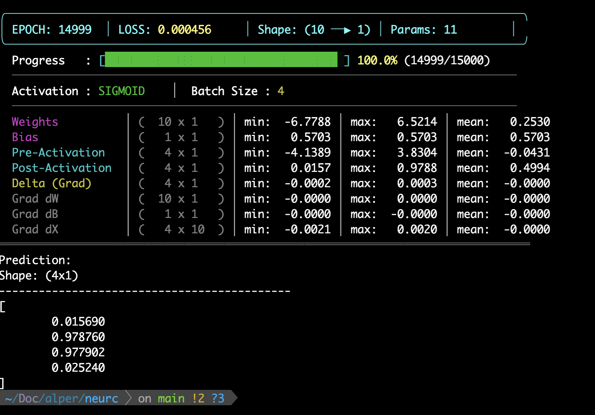

# neurc

A small neural network library written from scratch in C.

> **Note: This project is for learning purposes.**
> `neurc` is being written to understand how neural networks work under the hood. It is not designed for production use and makes no guarantees about speed, stability, or API compatibility. For real projects, use mature libraries such as PyTorch or TensorFlow.

## Goals

- Implement the forward pass, backpropagation, and training loop of a neural network step by step, without relying on existing ML libraries
- Practice memory management, data structure design, and clean C library API design
- Eventually make the library usable from Python via `import neurc`

## Status

The project is in an early stage and under active development. The list below is the roadmap; unchecked items are not done yet.

- [ ] Project skeleton and build system (Makefile, static library)
- [ ] Matrix data structure and basic operations
- [ ] Layers and multi-layer forward pass
- [ ] Activation functions (sigmoid, R# neurc


A lightweight neural network library written from scratch in pure C.

> **Note: This project is for learning purposes.**  
> `neurc` is built from the ground up to understand how neural networks, tensor operations, and automatic differentiation work under the hood. It is not intended for production use and makes no guarantees about speed, stability, or API compatibility. For real-world projects, use mature frameworks such as PyTorch or TensorFlow.

---

## Training Preview

Live terminal dashboard tracking layer shapes, activation statistics, gradient health, and loss convergence while solving the XOR problem:



---

## Goals

- Implement forward pass, backpropagation, and gradient descent step by step without relying on external ML libraries
- Practice explicit manual memory management, cache-friendly data structures, and clean C API design
- Build a high-level `Network` abstraction to seamlessly chain layers and automate training loops
- Eventually expose the library to Python via C-API / `ctypes` (`import neurc`)

---

## Roadmap & Status

The project is under active development. The XOR benchmark is currently working end-to-end with manual layer chaining; the next milestone is building the `Network` wrapper struct.

- [x] Project skeleton and build system (`Makefile`, static library)
- [x] Matrix data structure and basic linear algebra operations
- [x] Layer abstraction and multi-layer forward pass
- [x] Activation functions (`Sigmoid`, `ReLU`, `Tanh`, `Softmax`)
- [x] Loss functions (MSE) & loss gradients
- [x] Backpropagation (`backward`) and parameter updates (`update`)
- [x] Live ANSI terminal training dashboard & XOR example
- [ ] **Next:** `Network` / `Model` container abstraction (automatic forward/backward pass chaining)
- [ ] Optimizers (SGD with Momentum, Adam) & batch data loader
- [ ] MNIST digit classification example
- [ ] Shared library (`.so` / `.dll`) and Python bindings

---

## Quick Example: Solving XOR

Below is a minimal example demonstrating forward propagation, backpropagation, parameter updates, and live dashboard monitoring on the classic XOR gate:

```c
#include "errors.h"
#include "layer.h"
#include "loss.h"
#include "utils.h"
#include "dashboard.h"
#include <stdio.h>
#include <stdbool.h>

#define EPOCHS        15000
#define LR            0.3
#define HIDDEN_NEURONS 10

int main(void)
{
    seed(0);

    m_double inp_arr[8] = {
        0.0, 0.0,
        0.0, 1.0,
        1.0, 0.0,
        1.0, 1.0
    };
    m_double target_arr[4] = { 0.0, 1.0, 1.0, 0.0 };

    Matrix *input    = mat_create(4, 2, inp_arr);
    Matrix *target   = mat_create(4, 1, target_arr);
    Matrix *gradient = mat_create(target->row_size, target->col_size, NULL);

    Layer *input_layer  = create_layer(2, HIDDEN_NEURONS, 4, SIGMOID);
    Layer *output_layer = create_layer(HIDDEN_NEURONS, 1, 4, SIGMOID);

    for (size_t epoch = 0; epoch < EPOCHS; epoch++) {
        // Forward pass
        forward(input_layer, input);
        forward(output_layer, input_layer->post_activation);

        // Loss & Backpropagation
        m_double loss = mean_square_error(output_layer->post_activation, target);
        gradient_loss(output_layer->post_activation, target, gradient);
        backward(output_layer, gradient);
        backward(input_layer, output_layer->dX);

        // Parameter update
        update(input_layer, LR);
        update(output_layer, LR);

        // Live terminal dashboard
        print_layer(output_layer, epoch, EPOCHS, loss, false);
    }

    printf("Prediction:\n");
    mat_print(output_layer->post_activation);

    // Explicit cleanup
    destroy_layer(input_layer);
    destroy_layer(output_layer);
    mat_destroy(input);
    mat_destroy(target);
    mat_destroy(gradient);

    return NEURC_OK;
}eLU, etc.)
- [ ] Loss functions
- [ ] Backpropagation and gradient descent
- [ ] XOR example
- [ ] MNIST example
- [ ] Shared library (`.so`/`.dll`) and Python bindings

## Project layout

```
neurc/
├── include/neurc/   public headers
├── src/             implementation
├── tests/           tests
├── examples/        usage examples
├── data/            datasets (not tracked in the repo)
├── Makefile
└── README.md
```

## Building

```
make
```

To clean build artifacts:

```
make clean
```

Requirements: `gcc` and `make`.

## Design principles

- No external dependencies, only the C standard library and `libm`
- All public functions and types are prefixed with `neurc_`
- Library code never calls `exit()`; errors are returned to the caller
- Memory ownership is explicit: every function that creates an object has a matching `free`/`destroy` function

## License

Not decided yet.
